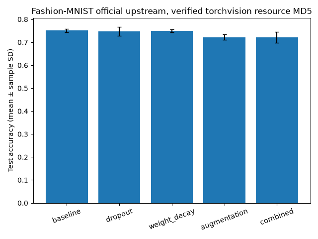
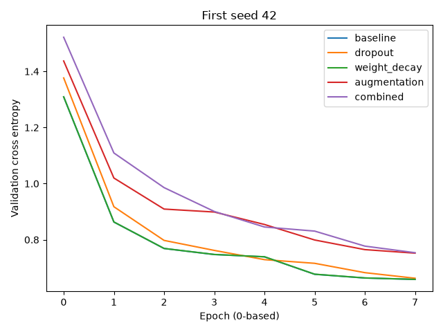

# Investigating generalization in neural networks

Controlled CPU experiments on dropout, weight decay and image augmentation using Fashion-MNIST, repeated seeds, explicit split isolation and genuinely measured learning curves.

[](https://github.com/ayanirfan099/investigating-generalization-in-neural-networks/actions/workflows/ci.yml)  [](LICENSE)




## Executed results

In the extended experiment, augmentation and combined treatment averaged 2.85 and 2.98 percentage points below baseline respectively (0.7222/0.7209 vs 0.7507). Smaller train–test gaps coincided with lower test accuracy. These rounded differences are descriptive; three optimization seeds do not establish significance.
Both pilot and extended experiments executed: 30 training runs total. All five treatments use the same declared budget within each study.

| Treatment | Test accuracy mean | Sample SD | Mean train–test gap |
|---|---:|---:|---:|
| baseline | 0.7507 | 0.0083 | 0.0173 |
| dropout | 0.7471 | 0.0198 | 0.0192 |
| weight_decay | 0.7493 | 0.0069 | 0.0181 |
| augmentation | 0.7222 | 0.0113 | 0.0091 |
| combined | 0.7209 | 0.0235 | 0.0106 |

[Extended machine-readable results](results/extended/metrics.json), [pilot](results/cpu/metrics.json).



## Reproduce
From this repository root:
```bash
python -m pip install -e '.[dev]'
python -m generalization.cli --data data --limit 1000 --epochs 3 --seeds 42 43 44 --output results/cpu
python -m generalization.cli --data data --limit 3000 --epochs 8 --seeds 42 43 44 --output results/extended
# Optional full benchmark:
python -m generalization.cli --data data --limit 48000 --epochs 30 --seeds 42 43 44 45 46 --output results/full
pytest -q
ruff check .
ruff format --check .
```

## Research question and methodology
Fashion-MNIST from the official zalandoresearch GitHub mirror, using torchvision published MD5 resource checks. Small CNN with identical parameter shapes and initial weights across treatments per seed. Fixed data split seed 2026 and official test subset seed 2027; 3,000 train, 750 validation, 750 official test images. Three optimization seeds (42,43,44), eight epochs, batch 64, AdamW learning rate 0.001. Five predetermined treatments: baseline, dropout p=0.3, weight decay 0.01, random horizontal flip plus small affine augmentation, and combined. Select each checkpoint on validation loss. Evaluate training accuracy with dropout disabled and no augmentation, matching validation/test evaluation mode. Log initial parameter hashes, data indices, epoch losses/accuracies, runtime and paired accuracy differences. Pilot (1,000/250/250, three epochs) retained separately; the larger budget was an exploratory extension for compute coverage, not tuning treatment values to test results.


## Implementation and review
`src/` contains the package and CLI; `tests/` contains CPU-safe unit and integration checks; `configs/` records defaults; `results/` stores measured metrics, not large datasets or checkpoints. See [methodology](docs/methodology.md), [reproducibility](docs/reproducibility.md), [status](docs/IMPLEMENTATION_STATUS.md), [quality review](docs/QUALITY_REVIEW.md) and [limitations](docs/limitations.md).

Four tests passed: identical initial parameter values across dropout configurations, deterministic fixed splits across seeds/treatments, invalid parameter/data bounds, repeated CPU training metric equality, checkpoint reload and CLI help. Tests use generated fixtures; committed research results use real Fashion-MNIST.

## Limitations and future work
Small single-dataset study with three seeds and a fixed 750-image test subset. Sample SD describes optimization variation, not confidence in general population accuracy. No significance claims. A larger budget was selected after inspecting pilot metrics, so regard the extension as exploratory rather than preregistered. No hyperparameter search was conducted, but no untouched confirmatory benchmark remains for this budget. Data augmentation changes optimization noise and may slow convergence. Eight epochs can still underfit. These runs do not reproduce the cited papers. Full 48,000/12,000/10,000 runs and additional seeds remain pending.

## References and licensing
Srivastava et al. (2014), *Dropout: A Simple Way to Prevent Neural Networks from Overfitting*, JMLR 15:1929–1958, https://jmlr.org/papers/v15/srivastava14a.html . Loshchilov & Hutter (2019), *Decoupled Weight Decay Regularization*, ICLR, arXiv:1711.05101. Simard, Steinkraus & Platt (2003), *Best Practices for Convolutional Neural Networks Applied to Visual Document Analysis*, ICDAR, DOI 10.1109/ICDAR.2003.1227801. Zhang et al. (2017), *Understanding deep learning requires rethinking generalization*, ICLR, arXiv:1611.03530. Xiao, Rasul & Vollgraf (2017), *Fashion-MNIST*, arXiv:1708.07747; official repository https://github.com/zalandoresearch/fashion-mnist (MIT).

Repository code: MIT; third-party data, pretrained weights and libraries retain their own terms. No affiliations, publications or independent authorship claims are made.
